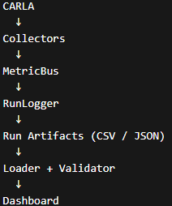
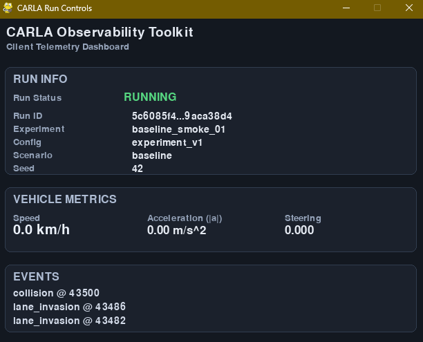
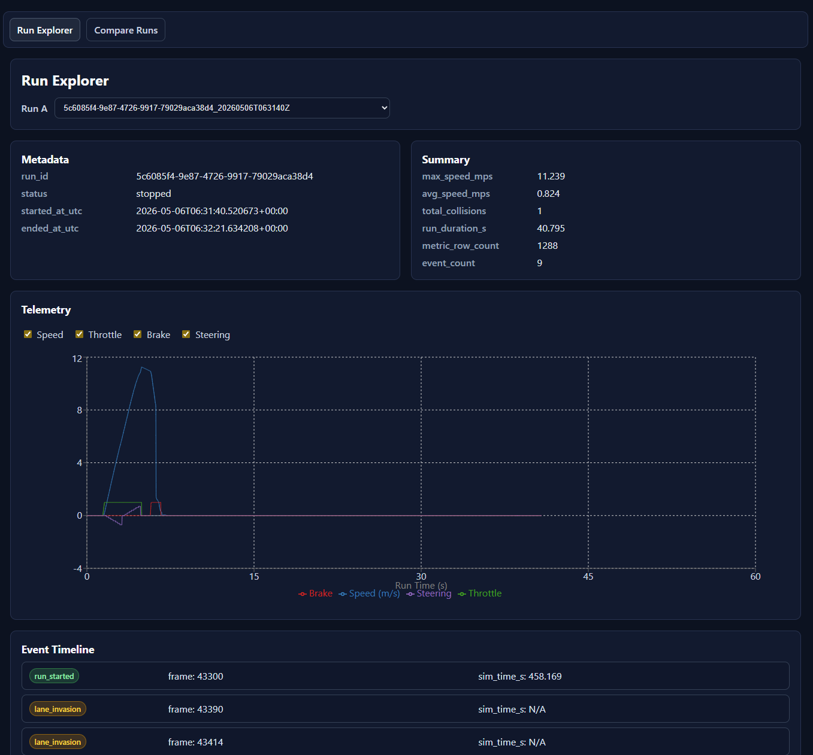
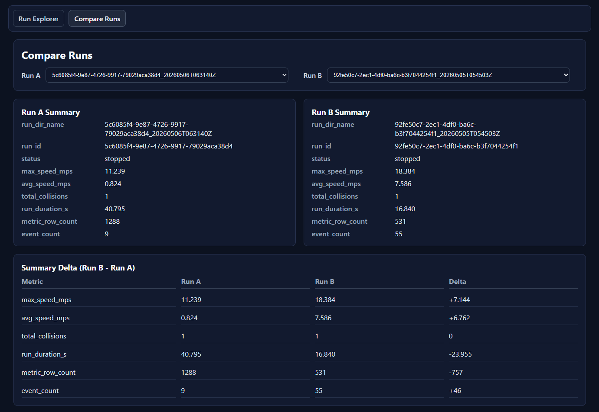
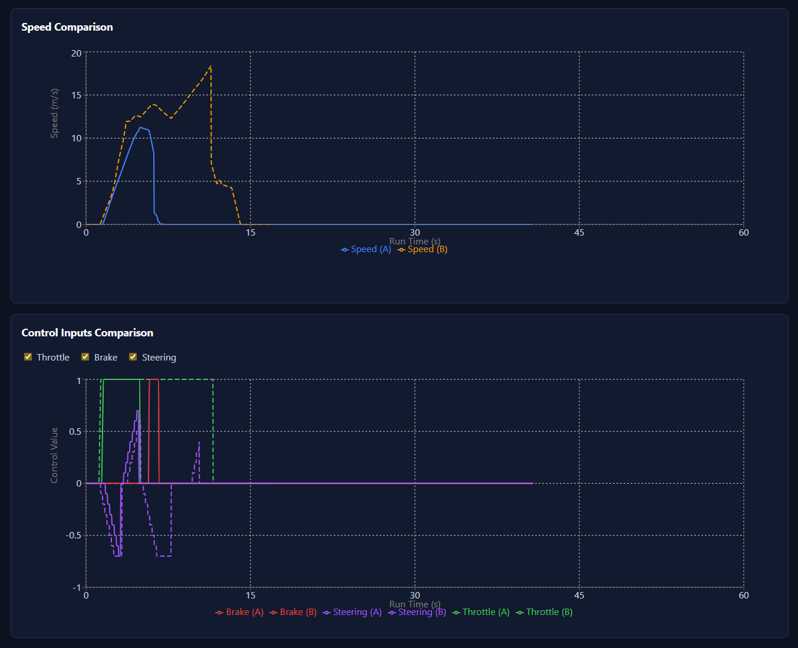

# CARLA Observability Toolkit

CARLA Observability Toolkit captures CARLA simulation telemetry as run-scoped datasets and provides a React dashboard for exploration and comparison. Each run is persisted as structured artifacts so results can be validated, analyzed, and reviewed consistently.

**Status:** Academic capstone / proof of concept. [v1.0.0](https://github.com/Dumpy250/carla-observability-toolkit/releases/tag/v1.0.0) is the final Spring 2026 submission.

[Portfolio case study](https://www.cameron-basham.com/projects/carla-observability-toolkit) · [Final presentation demo](https://www.youtube.com/watch?v=wsCNO4Om8qI)

## Project Overview

- Run-centric observability pipeline for CARLA simulation sessions
- Structured artifacts per run (`metadata.json`, `metrics.csv`, `events.json`)
- Flask API for run listing and run-detail loading
- React dashboard UI for exploration and comparison

## Repository Layout

- `frontend/` - React + Vite dashboard source
- `backend/` - Flask API + React production host (`backend/app.py`)
- `src/cot/` - observability/runtime pipeline
- `scripts/` - validation and report utilities
- `runs/` - generated run artifacts

## Quick Start

For local analysis or capture, complete [Setup](#setup) first; commands below run from the repository root unless a `cd` is shown.

- **Browse the project without installing:** start with the case study, final presentation, and [dashboard previews](#dashboard-preview).
- **Analyze saved runs:** place an existing run folder (with `metadata.json`, `metrics.csv`, and `events.json`) under `runs/`, then use [Single-Server Demo Mode](#single-server-demo-mode). CARLA does not need to be running. Generated `runs/` data is ignored by Git and is not bundled with a fresh checkout; the dashboard will have no runs until you supply or capture them.
- **Capture a new run:** follow the flow below. CARLA server, its example scripts, and a compatible Python client are separate prerequisites, not included in this repository.

Most common end-to-end capture flow:

1. Start CARLA server.
2. Run CARLA `manual_control.py`.
3. In another terminal, run:

```powershell
python src/cot/client/run_controls_smoke.py
```

4. Focus the COT run-controls window and press `F5` to start capture; switch to `manual_control.py` to drive, then return to the COT window and press `F6` to stop. See [keybindings](docs/keybindings.md).
5. Build the frontend:

```powershell
cd frontend
npm run build
cd ..
```

6. Start the backend service:

```powershell
python backend/app.py
```

Open `http://127.0.0.1:5000`.

## Run-Centric Pipeline

Each COT capture session creates a self-contained run directory under `runs/`. These generated datasets are the source of truth for validation, summary statistics, and dashboard views.

## Architecture



### Observability Pipeline

Collectors publish telemetry and events through the bus, runtime components persist run artifacts, and the backend/API layer reads those artifacts for analysis and visualization. The pipeline is designed so raw run output and derived summaries stay aligned.

Current package/layout highlights:

- `src/cot/bus` - pub/sub and metric bus infrastructure
- `src/cot/carla` - CARLA-specific adapters and integration helpers
- `src/cot/collectors` - telemetry and event collectors
- `src/cot/config` - configuration models/loading
- `src/cot/runtime` - run loading, summaries, and runtime orchestration
- `backend/app.py` - Flask API + React build serving
- `frontend/` - React + Vite dashboard source

## Run Artifacts

Each run directory in `runs/` contains three primary artifacts:

- `metadata.json` - run identity, timing, and high-level run state
- `metrics.csv` - frame/time-series telemetry values for charting and analysis
- `events.json` - ordered run events (for example lifecycle and collision events)

## Reproducibility and Analysis

Run-scoped artifacts make saved results reviewable: the same telemetry and events can be revisited without rerunning CARLA. Validation, summary reports, and dashboard analysis read these artifacts independently; a validation pass is not a prerequisite enforced by the dashboard. Saving artifacts does not by itself guarantee deterministic replay of a driving session.

## Frontend and API Model

- Flask provides API endpoints:
  - `GET /api/runs`
  - `GET /api/runs/<run_dir_name>`
- API documentation: [`docs/API.md`](docs/API.md)
- React app is built from `frontend/` into `frontend/dist`.
- In single-server mode, Flask serves the built React app from `frontend/dist`.
- Legacy Flask/Chart.js dashboard is deprecated and available only as fallback at `/legacy`.

## Setup

Examples use Windows PowerShell. Start at the repository root, and activate the environment in each Python terminal.

- Use a supported Python version compatible with the wheel supplied by the CARLA `0.10.0` package for your operating system. Follow the [release-specific CARLA installation guide](https://github.com/carla-simulator/carla/blob/0.10.0/Docs/start_quickstart.md); install that wheel into the virtual environment before the remaining requirements. `requirements.txt` does not pin Python packages, so installing it alone does not guarantee a matching CARLA client/server pair.
- For capture, also prepare the CARLA distribution's `PythonAPI/examples` dependencies for `manual_control.py`; the toolkit requirements are not a replacement for that example environment.
- Use a maintained Node.js 22.x release (at least 22.13.0) or 24.x, with npm. The checked-in lockfile resolves Vite 8.0.10 and ESLint 10.2.1; this satisfies both tools' Node requirements.

### Python

```powershell
python -m venv .venv
.\.venv\Scripts\Activate.ps1
# Before the next command, install the matching CARLA wheel into this environment
# using the release-specific guide above (wheel filename depends on Python/OS).
python -m pip install -r requirements.txt
```

### Frontend

```powershell
cd frontend
npm ci
npm run build
cd ..
```

## Running Modes

### Development Mode

Terminal 1:

```powershell
python backend/app.py
```

Terminal 2:

```powershell
cd frontend
npm run dev
```

Open the Vite localhost URL shown in terminal output. Its `/api` proxy targets the Flask backend at `http://127.0.0.1:5000`; both processes are needed in development mode.

### Single-Server Demo Mode

```powershell
cd frontend
npm run build
cd ..
python backend/app.py
```

Open `http://127.0.0.1:5000`.

## Dashboard Features

- Run Explorer page
- Compare Runs page
- Summary stats
- Normalized telemetry charts
- Event timeline
- Side-by-side run summaries with overlaid telemetry traces
- Speed and control comparison charts

## Dashboard Preview


Features shown:
- Telemetry visualization
- Event timeline
- Run metadata and summary statistics
- Normalized time-series charts

### Run Explorer


### Compare Runs



Features shown:
- Side-by-side run summaries with overlaid telemetry traces
- Delta analysis
- Speed comparison charts
- Control input comparison charts

## Normalization

- Telemetry charts normalize simulation time per run so comparisons begin at t=0 regardless of CARLA world uptime.

## Testing

The repository includes tracked Python tests under `tests/`. The commands below are source-checked instructions, not a new execution report. The [v1.0.0 release](https://github.com/Dumpy250/carla-observability-toolkit/releases/tag/v1.0.0) records prior pytest, compile, and frontend build checks. [TestPlan.md](docs/TestPlan.md) distinguishes executed checks, source-inspected behavior, and dependency-blocked startup attempts; its PASS entries should not all be read as live simulator/API/UI tests.

```powershell
python -m pytest -v
python -m compileall src scripts backend tests
```

Useful validation/report commands:

```powershell
python scripts/validate_run.py
python scripts/validate_runs.py
python scripts/validate_runs.py --last 3
python scripts/validate_runs.py --all
python scripts/generate_experiment_report.py "YOUR_RUN_DIRECTORY_NAME"
```
Replace `YOUR_RUN_DIRECTORY_NAME` with an existing folder name under `runs/`. Validation checks saved artifacts; report generation writes `summary_report.json` into the selected run folder.

## Demo Workflow

1. Prepare the official CARLA `0.10.0` package and matching Python client as described in [Setup](#setup).
2. Start the CARLA server from its installation directory (`CarlaUnreal.exe` on Windows). `start_carla_dev.bat` is not included in this repository; use it only if you have your own launcher.
3. Activate the virtual environment used for CARLA `PythonAPI/examples`.
4. Run `manual_control.py` to spawn/control a vehicle.
5. In a separate terminal, start the COT controls client:

```powershell
python src/cot/client/run_controls_smoke.py
```

6. Focus the COT run-controls window and press `F5` to start run capture.
7. Switch to `manual_control.py` and drive to generate telemetry.
8. Return to the COT run-controls window and press `F6` to stop.
9. Optionally validate the latest run artifacts (recommended before interpreting results):

```powershell
python scripts/validate_run.py
```

10. Build the frontend and start the backend service, then view results:

```powershell
cd frontend
npm run build
cd ..
python backend/app.py
```

Open `http://127.0.0.1:5000`.

Note: COT connects to CARLA over `localhost:2000` (default client settings: host `localhost`, port `2000`, timeout `10s`) and attaches to an existing active vehicle. The vehicle must exist and move to produce useful telemetry. `VehicleSpawner` is available for helper/spawn workflows, but the primary demo path currently uses `manual_control.py`.

## Limitations

- Intended for local demonstration and analysis, not a production-hosted service. `backend/app.py` starts Flask's loopback development server with debug mode enabled; do not expose it publicly.
- Python dependencies are unpinned, and capture requires a separately configured CARLA server/client/example environment. The historical test-plan Python version is not a guarantee of compatibility with every CARLA wheel.
- Screenshots and the linked presentation are recorded evidence, not a live hosted simulator.

## Tech Stack

- Python
- CARLA
- Flask
- React
- Vite
- Recharts
- JSON / CSV
- pytest
